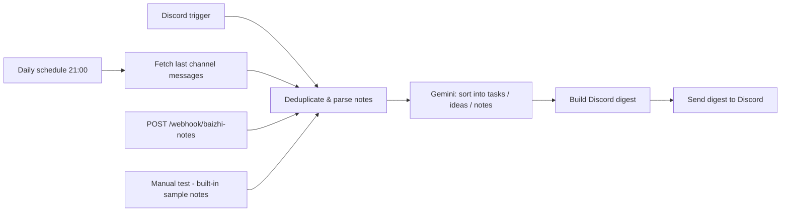

# Baizhi Notes Secretary (n8n)

A personal secretary on Discord. Drop quick notes and to-dos into a channel during the day; every evening it removes duplicates, asks Gemini to sort them into tasks, ideas and notes, and posts one clean digest back to Discord.

*Baizhi* is the name of the assistant persona used in the prompts; rename it freely.



## Features

- **Prefix filter:** only messages starting with `!N`, `!n`, `!note`, `!notes`, `!todo` or `!task` are captured; normal chat is ignored.
- **24-hour window:** older messages are dropped, so yesterday's notes never come back.
- **Duplicate removal:** exact, normalised (case, punctuation, Polish diacritics), subset and word-overlap (Jaccard ≥ 70%) matching; the richest version of a repeated note is kept.
- **AI digest:** Gemini 2.5 Flash groups notes into *Actionable Tasks*, *Ideas* and *General Notes*. If the call fails, a rule-based fallback still builds the digest.
- **Rich Discord embed** with checkboxes and counts (received, kept, duplicates, expired).

## Setup

1. **Credentials in n8n:**
   - *Discord Bot* (`discordOAuth2Api`) — a bot that can read the input channel and post to the output channel.
   - *Discord Bot Trigger* (`discordBotTriggerApi`) — only if you use the live Discord trigger; it comes from the community node [`n8n-nodes-discord-trigger`](https://www.npmjs.com/package/n8n-nodes-discord-trigger) (install it first, or delete that trigger node).
   - *Google Gemini (PaLM) API* — key from [Google AI Studio](https://aistudio.google.com/apikey).
2. **Workflows → Import from file** → [`Baizhi_Notes_Secretary.json`](Baizhi_Notes_Secretary.json) and select the credentials.
3. In *Fetch Discord Messages*, *Send Discord Digest* and *Discord Trigger* replace `YOUR_DISCORD_SERVER_ID` / `YOUR_DISCORD_CHANNEL_ID` (Discord: Settings → Advanced → Developer Mode, then right-click → *Copy ID*).
4. Click **Test workflow** (uses built-in sample notes) and activate it for the daily 21:00 digest.

## Usage

| Prefix | Example | Becomes |
| :--- | :--- | :--- |
| `!N` / `!todo` / `!task` | `!todo Send the invoice to the client` | Task |
| `!notes` | `!notes Idea: multi-agent routing in n8n` | Idea |
| `!note` | `!note Call moved to 15:30 tomorrow` | Note |

Other tools can push notes too:

```bash
curl -X POST https://<your-n8n>/webhook/baizhi-notes \
  -H "Content-Type: application/json" \
  -d '{"content": "!todo Renew the domain"}'
```

## Tests

[`test_secretary.py`](test_secretary.py) re-implements the parsing and deduplication rules in Python and tests them (prefixes, duplicates, diacritics, Markdown output, 24-hour window): `python test_secretary.py` (5 tests).

## Status

Verified on 2026-10-27 on a self-hosted n8n: real Discord channel read (100 messages, 24-hour filter applied), deduplication and digest building, with the Gemini response mocked and the final send disabled; all 5 Python tests passing.

## License

MIT, see [LICENSE](LICENSE). Built by [CyberResonance](https://cyberresonance.io).
